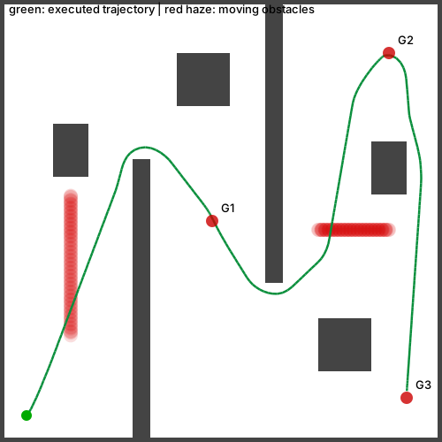
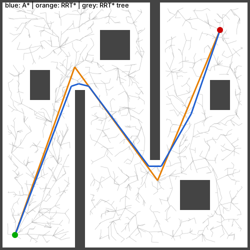

# motion-planning-cpp

Autonomous navigation stack in **C++17** (no dependencies): global path planning (**A\*** and **RRT\***), a **sampling-based MPC-style local controller** for obstacle avoidance, and a **mission executor** with automatic replanning, tested in simulation.



## Components
- **A\*** on an inflated occupancy grid (8-connected, octile heuristic, no corner cutting, line-of-sight smoothing)
- **RRT\*** (sampling-based, rewiring, goal bias, radius shrinking) on the same map
- **Receding-horizon controller**: rolls out candidate (v, w) commands over a 2.5 s horizon on a unicycle model with acceleration limits, rejects collisions with the static map and with *predicted* moving obstacles, scores by tracking error, clearance and speed, applies the best first command, repeats at 10 Hz. This is a sampling-based MPC (in the style of DWA/MPPI), not a QP solver
- **Mission executor** (state machine PLAN → EXECUTE → DONE/FAILED): multi-goal mission, replans when a moving obstacle threatens the upcoming path or the robot stalls
- SVG visualisation of planners and executed trajectory

## Results (simulation, 50 m x 50 m map, 2 moving obstacles)
| | A* | RRT* (3000 iter.) |
|---|---|---|
| Path length (3,3)->(44,44) | 87.8 m | 96.4 m |
| Planning time | ~1 ms | ~80 ms |

Mission with 3 goals: all goals reached, **0 collisions**, 3 replans, min clearance to static obstacles 0.25 m, 129.6 s, 127.8 m.



## Build and run
```
make run
```
or `g++ -std=c++17 -O2 -Iinclude -o planner src/main.cpp && ./planner`. Writes `planners.svg` and `mission.svg`.

## Limits and next steps
Simulation only: perfect localisation and a known obstacle motion model are assumed. Next: ROS2 wrapper, kinodynamic planning (hybrid A*), QP-based MPC, perception-driven obstacle tracking (see fusion-cpp).

Author: Farhan Bin Mujeeb. https://imfarhandev.netlify.app/ | https://sa.linkedin.com/in/farhanbinmujeeb
